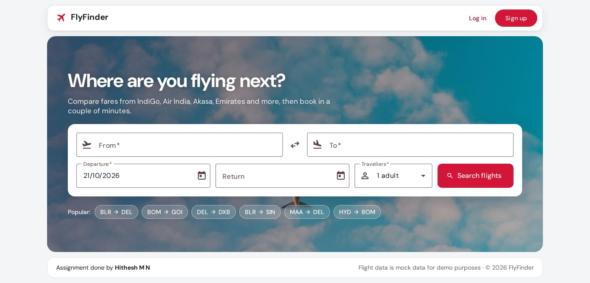
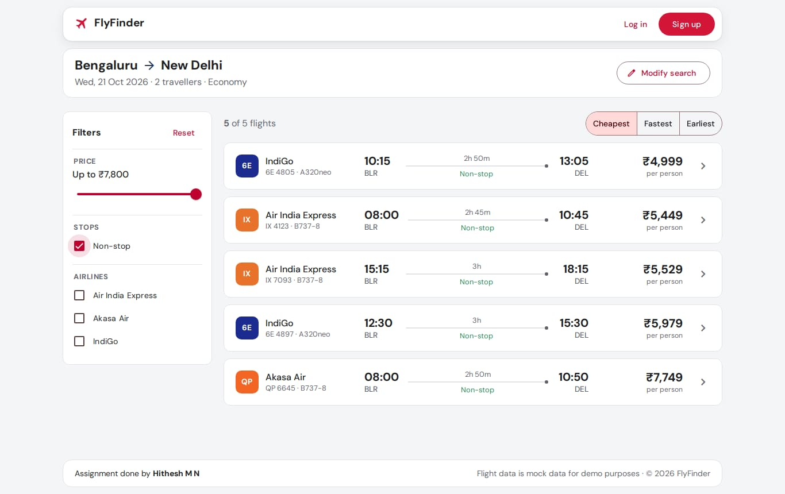
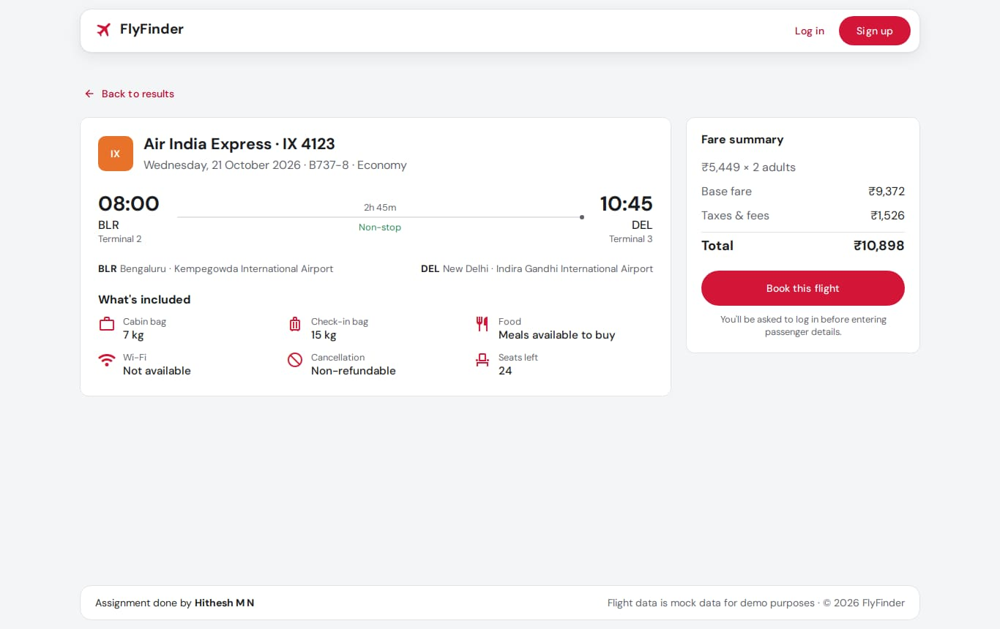
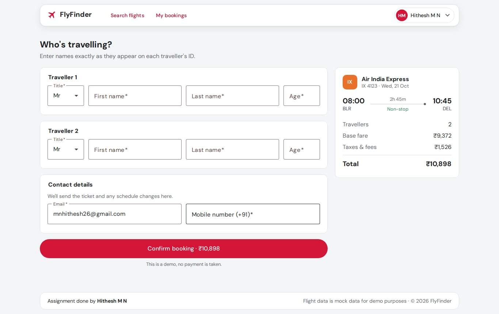
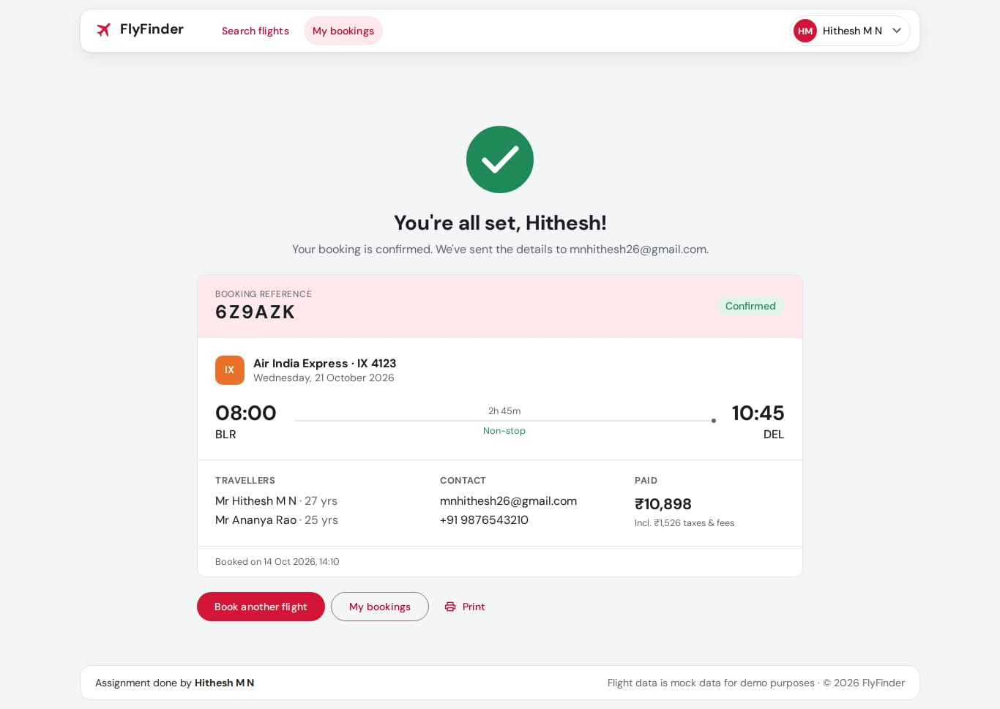
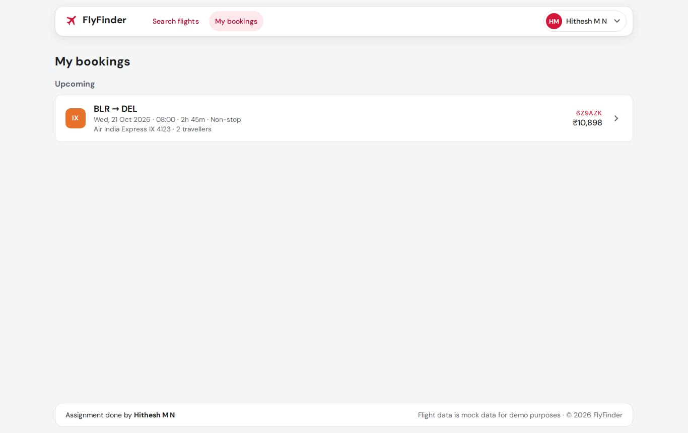
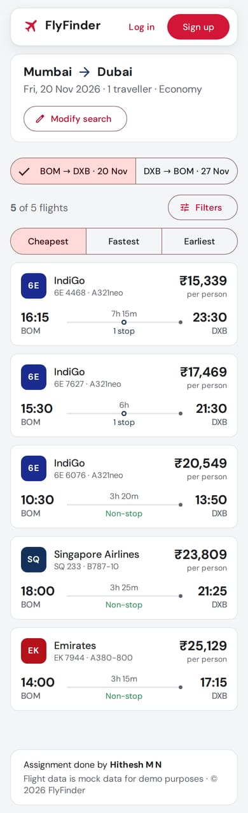

# FlyFinder – Flight Search & Booking (Angular 18)

FlyFinder is a small travel search app built for the *Angular Task – REST API Integration* assignment.
You search for flights, filter and sort the results, open a flight's details, and book it
after logging in. All data comes from a local mock REST API that starts together with the app,
so there are no accounts or API keys to set up.



**Demo login**

| Email                   | Password |
| ----------------------- | -------- |
| `mnhithesh26@gmail.com` | `12345`  |

You can also create a new account from **Sign up**.

---

## Contents

1. [Quick start](#1-quick-start)
2. [Step-by-step setup](#2-step-by-step-setup)
3. [Using the app (walkthrough)](#3-using-the-app-walkthrough)
4. [Available scripts](#4-available-scripts)
5. [Technologies used](#5-technologies-used)
6. [Features](#6-features)
7. [API details](#7-api-details)
8. [Project structure](#8-project-structure)
9. [Key implementation decisions](#9-key-implementation-decisions)
10. [Assumptions](#10-assumptions)
11. [Testing](#11-testing)
12. [Troubleshooting](#12-troubleshooting)
13. [How the assignment requirements are covered](#13-how-the-assignment-requirements-are-covered)

---

## 1. Quick start

```bash
git clone https://github.com/MnHithesh/pratra_assignment.git
cd pratra_assignment
npm install
npm start
```

Open **http://localhost:4200** and log in with the demo account above.

## 2. Step-by-step setup

### Prerequisites

| Tool    | Version                                    | Check with      |
| ------- | ------------------------------------------ | --------------- |
| Node.js | 18.19+, 20.11+ or 22+ (tested on Node 24)  | `node -v`       |
| npm     | 9+                                         | `npm -v`        |
| Git     | any recent version                         | `git --version` |

The Angular CLI doesn't need a global install. The project uses its local copy through the npm scripts.

### Steps

1. **Clone the repository**

   ```bash
   git clone https://github.com/MnHithesh/pratra_assignment.git
   cd pratra_assignment
   ```

2. **Install dependencies**

   ```bash
   npm install
   ```

3. **Start the app and the mock API together**

   ```bash
   npm start
   ```

   This uses `concurrently` to run two processes. Their output is prefixed in the terminal:

   - `[api]` is the mock REST API on **http://localhost:3000**. It prints `Mock API running at http://localhost:3000`.
   - `[web]` is the Angular dev server on **http://localhost:4200**.

   > Run `npm start`, not just `ng serve`. `ng serve` only starts the Angular app, so every API call fails
   > and the page shows *"We couldn't load the airport list"*.

4. **Open the app** at http://localhost:4200.

5. **Log in** with `mnhithesh26@gmail.com` / `12345`, or sign up. You only need to log in to book.
   Searching and viewing flights are open to everyone.

6. **Stop** both servers with `Ctrl + C` in the terminal.

### Running the two parts separately (optional)

```bash
# terminal 1
npm run mock:api

# terminal 2
npm run serve
```

### How the frontend reaches the API

The app calls `/api/...`. The dev server proxies these calls to the mock API (see `proxy.conf.json`), so
there are no CORS settings to deal with:

```
browser → http://localhost:4200/api/flights?from=BLR&to=DEL
        → proxy →  http://127.0.0.1:3000/flights?from=BLR&to=DEL
```

## 3. Using the app (walkthrough)

1. **Search**: on the home page, type in **From** and **To** (e.g. `beng` → *Bengaluru (BLR)*), pick a
   departure date, an optional return date and the number of travellers, then press **Search flights**.
   You can also click one of the **Popular** route chips.
2. **Results**: flights for that route and date. Use the filters on the left (max price, stops,
   airline) and the **Cheapest / Fastest / Earliest** sort. If you chose a return date, a toggle at the top
   switches between the onward and return flights. **Modify search** changes the search in place.
3. **Details**: click any flight to see terminals, layovers, baggage, meals, Wi-Fi, refund policy,
   seats left and the fare summary.
4. **Book**: press **Book this flight**. If you aren't logged in, you're taken to the login page, which
   then sends you straight back to the booking.
5. **Traveller details**: fill in title, first and last name and age for each traveller, plus a contact
   email and mobile number, then press **Confirm booking**. No payment is taken.
6. **Confirmation**: a short plane-and-tick animation plays, then your booking reference and ticket summary appear.
7. **My bookings**: the logged-in header has **My bookings** with your upcoming and past trips.
   The profile menu (top right) has **Log out**.

| Results | Details |
| ------- | ------- |
|  |  |

| Booking | Confirmation |
| ------- | ------------ |
|  |  |

| My bookings | Mobile |
| ----------- | ------ |
|  |  |

### Pages / routes

| Route             | Page                                    | Login needed |
| ----------------- | --------------------------------------- | ------------ |
| `/`               | Hero landing page with the search form  | No           |
| `/flights`        | Search results + filters                | No           |
| `/flights/:id`    | Flight details                          | No           |
| `/login`          | Log in                                  | Guests only  |
| `/signup`         | Sign up                                 | Guests only  |
| `/book/:flightId` | Traveller details and booking           | **Yes**      |
| `/bookings`       | My bookings                             | **Yes**      |
| `/bookings/:id`   | Booking confirmation / details          | **Yes**      |
| `**`              | Page not found                          | No           |

## 4. Available scripts

| Command              | What it does                                                        |
| -------------------- | ------------------------------------------------------------------- |
| `npm start`          | Starts the mock API (port 3000) and the Angular app (port 4200)     |
| `npm run serve`      | Starts only the Angular dev server                                  |
| `npm run mock:api`   | Starts only the mock API                                            |
| `npm run mock:reset` | Deletes saved bookings and new users (back to the seed data)        |
| `npm test`           | Runs the unit tests in Chrome (Karma + Jasmine)                     |
| `npm run build`      | Production build into `dist/flyfinder`                              |

Mock API settings (environment variables):

| Variable           | Default | Meaning                                             |
| ------------------ | ------- | --------------------------------------------------- |
| `MOCK_API_PORT`    | `3000`  | Port of the mock API                                |
| `MOCK_API_LATENCY` | `600`   | Delay (ms) added to every response, so loaders show |

```bash
# macOS / Linux / Git Bash
MOCK_API_LATENCY=0 npm run mock:api

# Windows PowerShell
$env:MOCK_API_LATENCY=0; npm run mock:api
```

## 5. Technologies used

| Area          | Choice                                                                                  |
| ------------- | --------------------------------------------------------------------------------------- |
| Framework     | **Angular 18.2**: standalone components, signals, `@if` / `@for` / `@switch` / `@let`   |
| Language      | TypeScript 5.5 (strict mode)                                                             |
| UI            | **Angular Material 18** with a custom Material 3 theme generated from the brand colour `#D31638` |
| Forms         | Typed **Reactive Forms**: `FormGroup`, `FormArray`, `FormRecord`, custom validators      |
| HTTP          | **HttpClient** with functional interceptors                                              |
| Async         | **RxJS 7**                                                                               |
| Routing       | Angular Router: lazy-loaded pages, functional guards                                     |
| Mock API      | json-server 0.17 with a small custom Express layer                                       |
| Tests         | Karma + Jasmine, `HttpTestingController`                                                 |
| Fonts / icons | DM Sans, Material Symbols                                                                |

## 6. Features

**Search form (Reactive Forms)**
- From / To use autocomplete. You can search by city, airport code or airport name.
- Swap button, departure date, optional return date, travellers (1–9).
- Validation:
  - Required fields.
  - The airport must be chosen from the list.
  - From and To must be different.
  - The departure date can't be in the past.
  - The return date can't be before the departure date.
  - Travellers must be between 1 and 9.
- Error messages appear under each field.

**REST API integration**
- All HTTP calls go through services: `FlightService`, `AirportService`, `AuthService` and `BookingService`.
- Each page has loading, empty and error states. The error state has a **Try again** button.

**Search results**
- Each result shows the airline, flight number, departure and arrival times, duration, price and number of stops.
- Arrivals on a later day are marked with **+1**, and a "seats left" warning appears when seats are low.

**Filtering and sorting (RxJS)**
- Max price slider, stops (non-stop / 1 stop / 2+ stops) and airline checkboxes.
- Sort by cheapest, fastest or earliest.
- A results counter ("5 of 12 flights"), and a "Clear filters" option when nothing matches.

**Flight details**
- A separate routed page that can be bookmarked or shared.

**Auth and booking**
- Sign up and log in. The session is saved in `localStorage` and the token expiry is checked.
- An auth guard protects booking, with a `returnUrl` so you come back to where you were.
- A booking form with one set of fields per traveller (dynamic `FormArray`).
- A confirmation page with an animation and a printable ticket.
- **My bookings**, split into upcoming and past trips.

**Layouts**
- *Public layout*: the header has **Log in** and **Sign up**.
- *Member layout*: the header has **Search flights**, **My bookings** and a profile menu with **Log out**.
- There's no side nav. Both layouts share the same footer (*"Assignment done by Hithesh M N"*).
- The header and footer are boxed inside the page container.
- The landing page fits a laptop screen (1280×720 and up) without scrolling.

**Responsive**
- Works down to small phones.
- On mobile:
  - The header links collapse into a menu button.
  - The filters move into a toggle panel.
  - The forms stack into one column.

## 7. API details

The mock API lives in `mock-api/`:

| File        | Purpose                                                                                                  |
| ----------- | -------------------------------------------------------------------------------------------------------- |
| `seed.json` | Starting data: 10 airports, 168 flights on 28 routes (Indian domestic plus Dubai and Singapore), 1 demo user |
| `server.js` | json-server plus custom routes for auth and bookings                                                     |
| `db.json`   | The live database. Created from `seed.json` on first start, git-ignored                                  |

### Endpoints

| Method | Endpoint                   | Auth | Description                                               |
| ------ | -------------------------- | ---- | --------------------------------------------------------- |
| GET    | `/airports`                | –    | All airports (for the autocomplete)                       |
| GET    | `/flights?from=BLR&to=DEL` | –    | Flights on a route                                        |
| GET    | `/flights/:id`             | –    | One flight                                                |
| POST   | `/auth/login`              | –    | Log in. Returns a token and the user                      |
| POST   | `/auth/signup`             | –    | Create an account. Returns a token and the user           |
| GET    | `/bookings`                | ✔    | The current user's bookings (`_sort`, `_order` supported) |
| GET    | `/bookings/:id`            | ✔    | One booking (404 if it belongs to another user)           |
| POST   | `/bookings`                | ✔    | Create a booking                                          |

Authenticated requests send `Authorization: Bearer <token>`. The Angular `authInterceptor` adds this header
automatically. `/users` is blocked so passwords are never returned, and bookings can't be edited or deleted
through the API.

### Examples

**Search**: `GET /flights?from=BLR&to=DEL`

```json
[
  {
    "id": "1",
    "airline": "Akasa Air",
    "airlineCode": "QP",
    "flightNumber": "QP 6645",
    "from": "BLR",
    "to": "DEL",
    "departure": "08:00",
    "durationMinutes": 170,
    "stops": 0,
    "layovers": [],
    "price": 7749,
    "currency": "INR",
    "aircraft": "B737-8",
    "cabinClass": "Economy",
    "seatsLeft": 16,
    "terminal": { "departure": "1", "arrival": "1" },
    "baggage": { "cabin": "7 kg", "checkIn": "15 kg" },
    "refundable": false,
    "meal": "Meals available to buy",
    "wifi": false
  }
]
```

**Login**: `POST /auth/login`

```jsonc
// request
{ "email": "mnhithesh26@gmail.com", "password": "12345" }

// 200 response
{ "token": "eyJzdWIiOjEs…", "user": { "id": 1, "name": "Hithesh M N", "email": "mnhithesh26@gmail.com" } }

// 401 response
{ "message": "Incorrect email or password." }
```

**Create booking**: `POST /bookings` (with a Bearer token)

```jsonc
// request
{
  "flightId": "1",
  "travelDate": "2026-10-21",
  "flight": { "airline": "Akasa Air", "flightNumber": "QP 6645", "from": "BLR", "to": "DEL" /* … */ },
  "passengers": [{ "title": "Mr", "firstName": "Hithesh", "lastName": "M N", "age": 27 }],
  "contact": { "email": "mnhithesh26@gmail.com", "phone": "9876543210" },
  "fare": { "baseFare": 6664, "taxes": 1085, "total": 7749, "currency": "INR" }
}

// 201 response: the request body plus the fields the server adds
{ /* … */ "id": "mv84g48p", "userId": 1, "reference": "3DBYEM", "status": "CONFIRMED", "createdAt": "2026-10-14T13:04:22.393Z" }
```

### Error responses

All errors return JSON `{ "message": "..." }` with the right status code:
- `400` for invalid input
- `401` when not logged in or the token has expired
- `404` when something isn't found
- `409` when the email is already registered

## 8. Project structure

```
pratra_assignment/
├── mock-api/                 # mock REST API (server.js, seed.json)
├── docs/screenshots/         # images used in this README
├── public/images/            # hero image (resized from the original Unsplash photo)
├── proxy.conf.json           # /api → http://127.0.0.1:3000
└── src/
    ├── styles.scss           # global styles, design tokens, Material theme
    ├── styles/               # generated M3 palette, breakpoint mixins
    └── app/
        ├── app.config.ts     # providers: router, HttpClient + interceptors, locale, Material defaults
        ├── app.routes.ts     # lazy-loaded routes and guards
        ├── core/             # app-wide logic, no UI
        │   ├── guards/       # authGuard, guestGuard
        │   ├── http/         # auth + error interceptors, ApiError, retryTransient, API_BASE_URL token
        │   ├── models/       # Flight, Airport, Booking, User, search types
        │   ├── services/     # FlightService, AirportService, AuthService, BookingService
        │   └── utils/        # pure helpers: dates, filtering/sorting/fare, URL <-> search criteria
        ├── layout/           # public & member layouts, both headers, footer, brand
        ├── shared/           # reusable building blocks
        │   ├── components/   # flight-search-form, flight-card, flight-timeline, airline-logo,
        │   │                 # loading-state, message-panel
        │   ├── pipes/        # duration (170 → "2h 50m"), stops (0 → "Non-stop")
        │   └── validators/   # flight search validators, matching fields
        └── features/
            ├── home/         # hero + search
            ├── flights/      # results, filters, details
            ├── auth/         # login, signup
            ├── booking/      # booking form, confirmation (+ animation), my bookings
            └── not-found/
```

## 9. Key implementation decisions

- **Search criteria live in the URL**, e.g. `/flights?from=BLR&to=DEL&depart=2026-11-20&return=2026-11-27&pax=2`.
  Refresh, back/forward and sharing a link all work. The results page simply reacts to `queryParamMap`,
  and broken links show a friendly "start a search" message.
- **RxJS on the results page:**
  - `switchMap` cancels an in-flight request when the user searches again.
  - `combineLatest` merges the results with the filter and sort streams.
  - `debounceTime` + `distinctUntilChanged` stop the list from recalculating on every slider tick.
  - `shareReplay` makes sure one search runs only one HTTP call, however many parts of the page use it.
  - A `Subject` drives the "Try again" button.
- **One view state per page**: `loading | loaded | error`, built with `startWith` + `catchError` and
  rendered with `@switch`. This avoids keeping separate `isLoading` / `error` flags in sync.
- **Error handling in three layers:**
  - The `errorInterceptor` turns every `HttpErrorResponse` into an `ApiError` with a readable message.
    On a 401 from an expired session it logs the user out and sends them to login.
  - `retryTransient()` retries once, and only for network or 5xx errors. A 404 or 400 is not retried,
    and creating a booking (POST) is never retried, to avoid double bookings.
  - Pages show the message with **Try again** or a way out.
- **Filtering and sorting are pure functions** in `core/utils/flight.util.ts`. This keeps components thin
  and the logic easy to unit test.
- **Reusable components**:
  - `FlightSearchFormComponent` is used both as the hero form and as the compact "Modify search" form.
  - `FlightTimelineComponent` appears on result cards, details, booking and confirmation.
  - `MessagePanelComponent` handles every empty and error state.
- **Layouts switch on auth state**: `AppComponent` renders the public or the member layout. The routes
  are the same for both, and only the booking pages are guarded.
- **Signals for local UI state** (toggles, submitting flags, the session). **Observables for async data**
  (HTTP, route params, filter streams).
- Every component uses `OnPush` change detection, and every page is lazy loaded (initial bundle ≈ 154 kB gzipped).
- The theme is generated with `ng generate @angular/material:m3-theme` from `#D31638`. App-specific colours
  are CSS custom properties in `styles.scss`, so they're easy to change in one place.
- No state management library and no extra UI kit besides Material. Services plus RxJS are enough here.

## 10. Assumptions

- Flights operate **daily**. The API stores the departure time (`"HH:mm"`) and the app puts it on the
  searched date, so the mock data works for any date. If you search for today, flights that have already left are hidden.
- The listed price is the all-in price **per adult**. The fare breakdown shows about 14% of it as taxes and fees.
- Economy class only. Every traveller is treated as an adult (age is still captured), with a maximum of 9 per booking.
- A return trip is shown as two one-way searches (onward and return toggle), and each flight is booked separately.
- There is no real payment. **Confirm booking** saves the booking straight away.
- Auth is mocked. The token is base64-encoded JSON with an expiry, and passwords are stored in plain text in the
  mock database. This is fine for a demo, not for production.
- The contact phone is validated as a 10-digit Indian mobile number.
- The airport list, prices and schedules are made up for the demo.

## 11. Testing

```bash
npm test                                              # watch mode in Chrome
npx ng test --watch=false --browsers=ChromeHeadless   # single run, headless
```

There are 25 unit tests in total:

| Spec                                    | Covers                                                               |
| --------------------------------------- | -------------------------------------------------------------------- |
| `core/utils/flight.util.spec.ts`        | placing schedules on a date, filters, sorting, filter options, fare maths |
| `core/utils/date.util.spec.ts`          | local date formatting/parsing, invalid dates, day differences        |
| `core/utils/search-params.util.spec.ts` | URL ↔ search criteria, defaults, rejecting broken links              |
| `shared/validators/…spec.ts`            | airport selected, not in past, different airports, return after departure |
| `shared/pipes/duration.pipe.spec.ts`    | minutes → "2h 50m"                                                   |
| `core/services/flight.service.spec.ts`  | HTTP params, retry on 503, no retry on 404, friendly errors          |
| `core/guards/auth.guard.spec.ts`        | logged-in pass-through, redirect to login with `returnUrl`           |

## 12. Troubleshooting

| Problem | Fix |
| ------- | --- |
| *"We couldn't load the airport list"* or `http proxy error … ECONNREFUSED` in the terminal | The mock API isn't running. Use `npm start` (not `ng serve`), or run `npm run mock:api` in a second terminal. |
| `npm install` fails with `ENOTEMPTY` | Close other terminals or editors using the folder, delete `node_modules` (`rm -rf node_modules`, or `Remove-Item -Recurse -Force node_modules` in PowerShell) and run `npm install` again. |
| `Port 4200 is already in use` | Stop the other dev server, or run `npm run serve -- --port 4300`. |
| Port 3000 is already in use | Run the API on another port (`MOCK_API_PORT=3001 npm run mock:api`, or `$env:MOCK_API_PORT=3001; npm run mock:api` in PowerShell) and change the port in `proxy.conf.json` to match. |
| Strange build or cache errors after switching branches | Delete the `.angular` folder and start again. |
| You want to clear test bookings or new accounts | Stop the app, run `npm run mock:reset`, start again. |
| Logged out unexpectedly | The mock token lasts 8 hours. Just log in again. |

## 13. How the assignment requirements are covered

| Requirement from the task | Where |
| ------------------------- | ----- |
| Search form: From, To, Departure, Return, Passengers, Search, Reactive Forms with validation | `shared/components/flight-search-form`, `shared/validators` |
| REST API through a separate Angular service, mock API allowed | `core/services/*.service.ts`, `mock-api/` |
| Loading and error messages | `loading-state`, `message-panel`, `core/http/error.interceptor.ts` |
| Results with airline, flight no., departure, arrival, duration, price, stops | `shared/components/flight-card`, `flight-timeline` |
| At least two filters, using RxJS | `features/flights/flight-filters` + `flight-results` (price, stops, airline) |
| Details page or modal on click | `features/flights/flight-details` (`/flights/:id`) |
| Angular 18+, TypeScript, Reactive Forms, HttpClient, RxJS, Routing | throughout. See sections 5 and 9 |
| Reusable components, services, error handling | sections 8 and 9 |
| Responsive UI | tested from 390 px phones to 1920 px desktops |
| Clean, maintainable code | `core` / `shared` / `features` split, OnPush, pure helpers, unit tests |
| Git / version control | small, focused commits in this repository |
| README: setup, technologies, API details, decisions, assumptions | sections 2, 5, 7, 9, 10 |

---

Assignment done by **Hithesh M N**.
